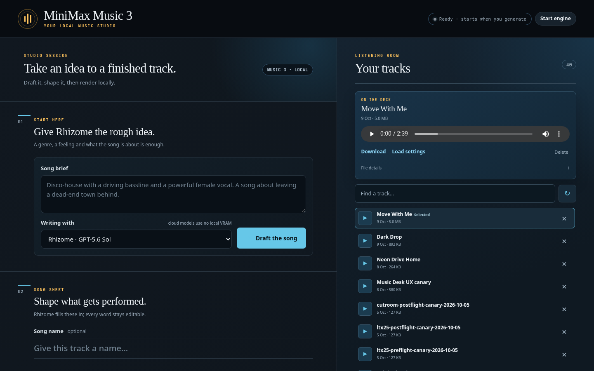
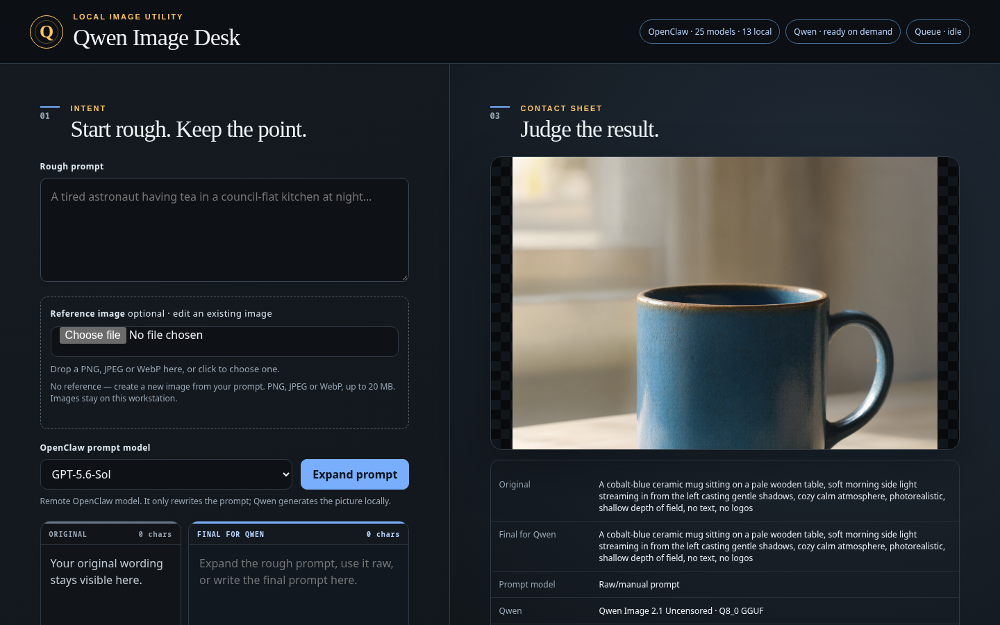
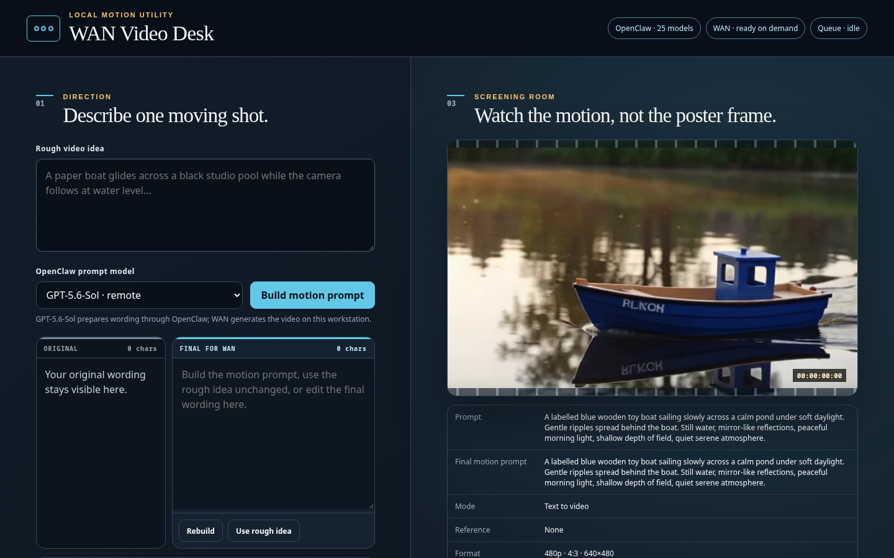
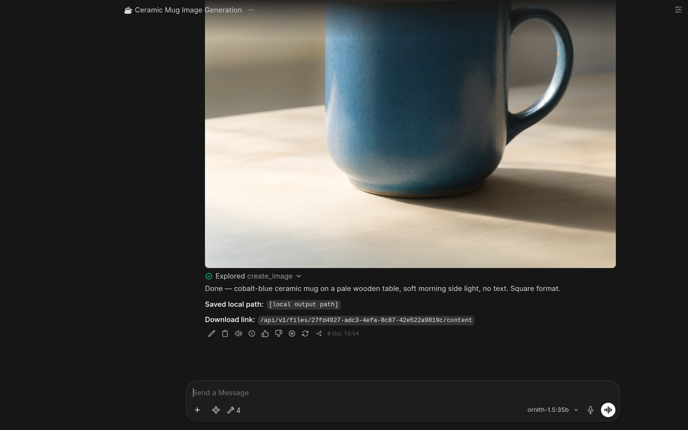
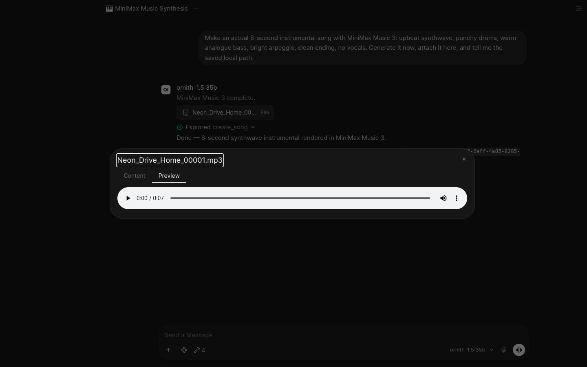
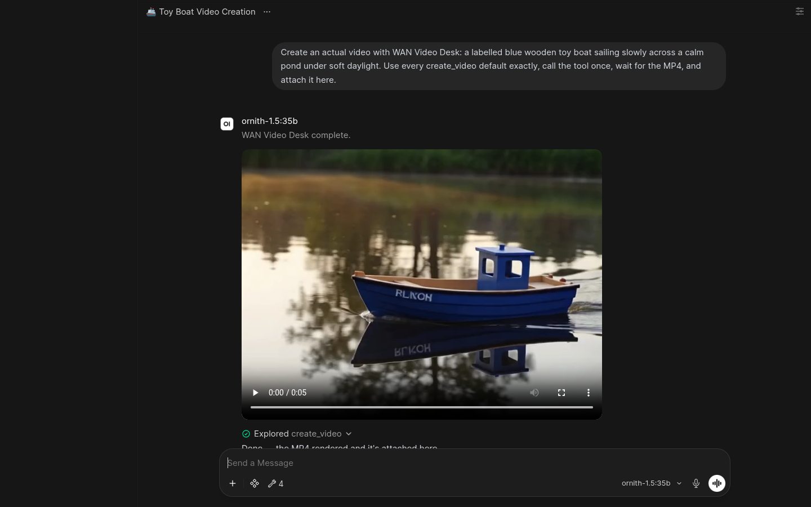

# Browser showcase

These screenshots were captured from the accepted reference-machine browser
paths on 16 October 2026. They demonstrate UI integration; they do not bundle
the pictured media, chats, user database, browser profile or model weights.
The Open WebUI captures use real saved canary chats with the identity sidebar
hidden and local absolute paths replaced before capture.

## Standalone creative apps

### MiniMax Music 3

### Qwen Image Desk

### WAN Video Desk

## Open WebUI saved-chat embeds

### Inline Qwen PNG

### Native MiniMax MP3 Preview

### Inline WAN MP4

The PNG uses Open WebUI's normal image branch. The MP3 uses its native File
card and Preview tab. The MP4 uses the version-pinned, hash-guarded frontend
replacement documented in [Open WebUI local media](OPENWEBUI_MEDIA.md).
