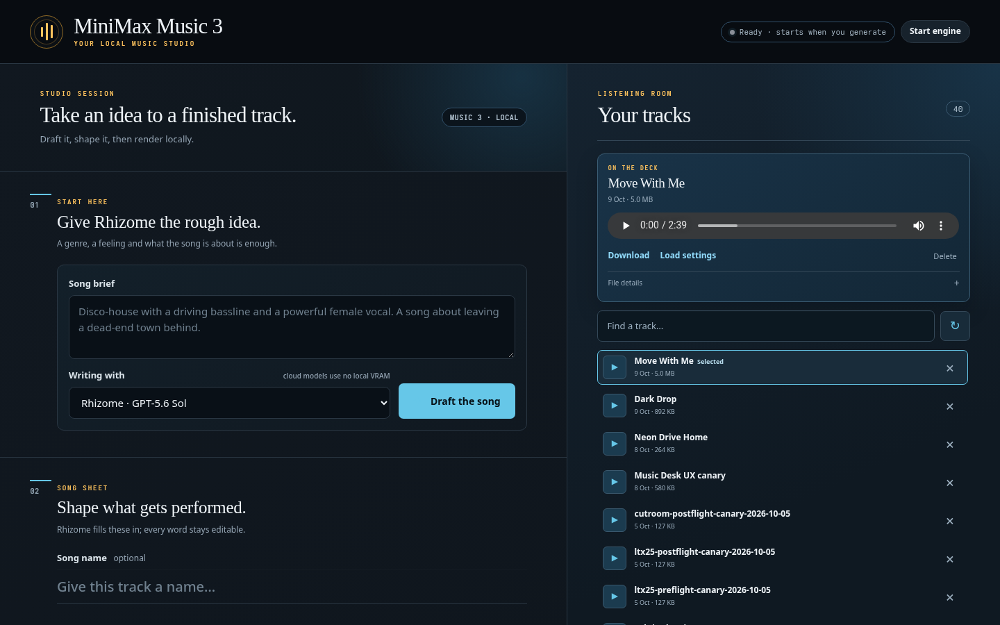
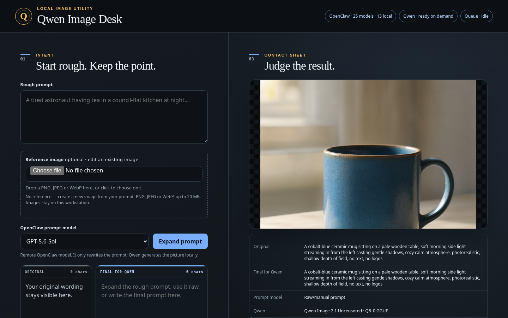
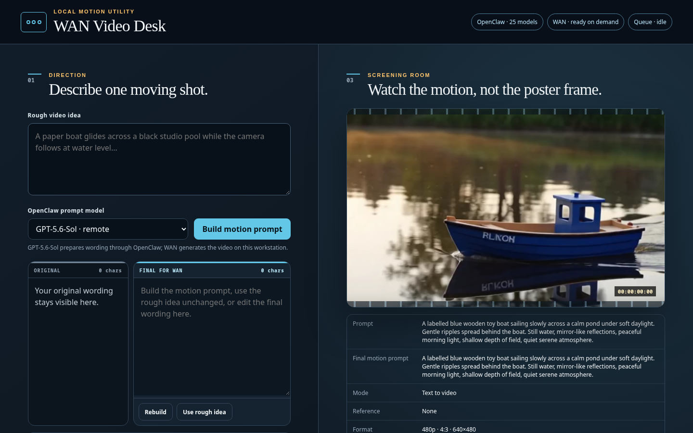
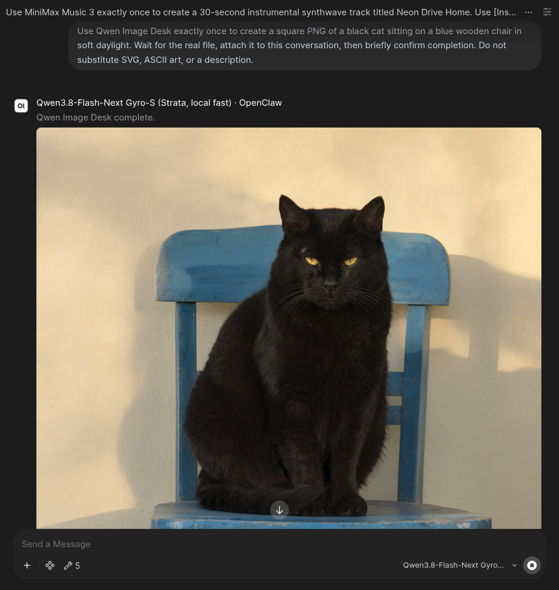
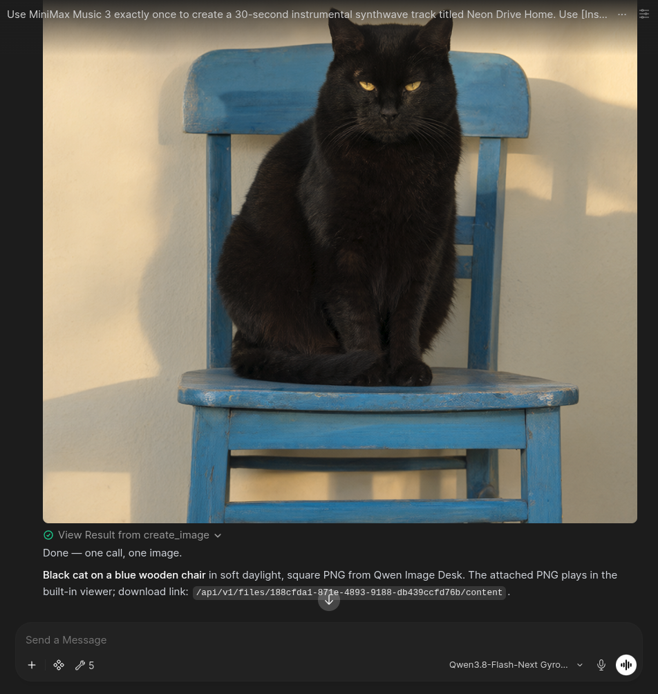
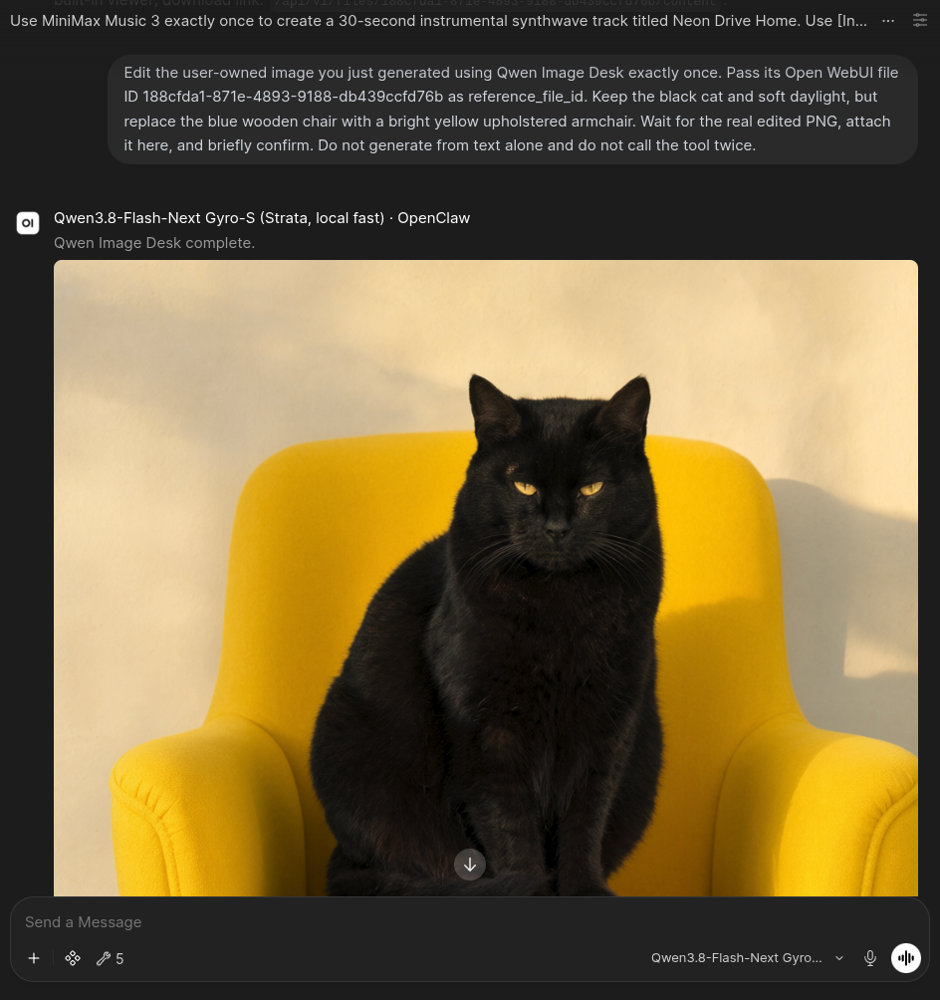
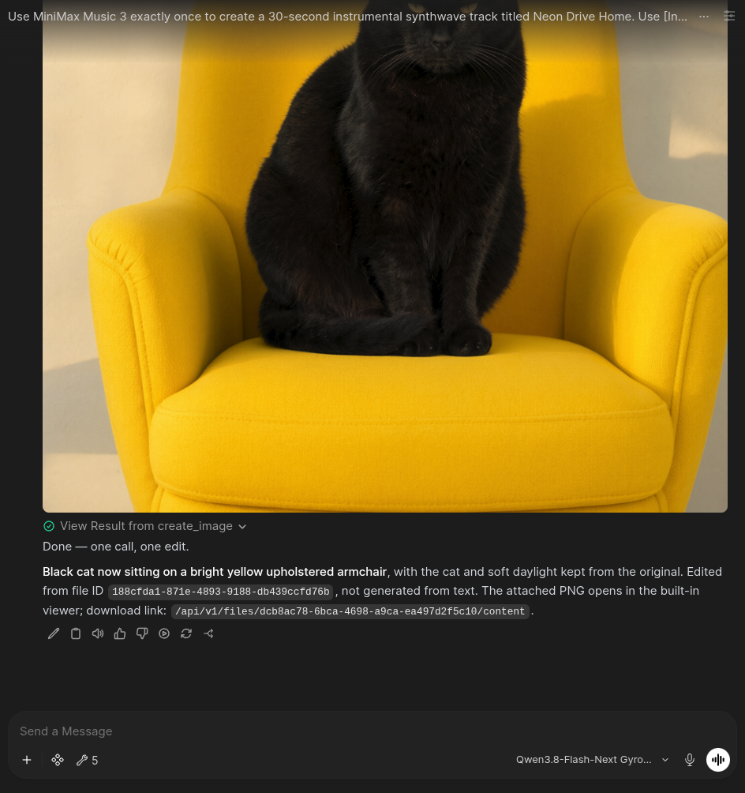
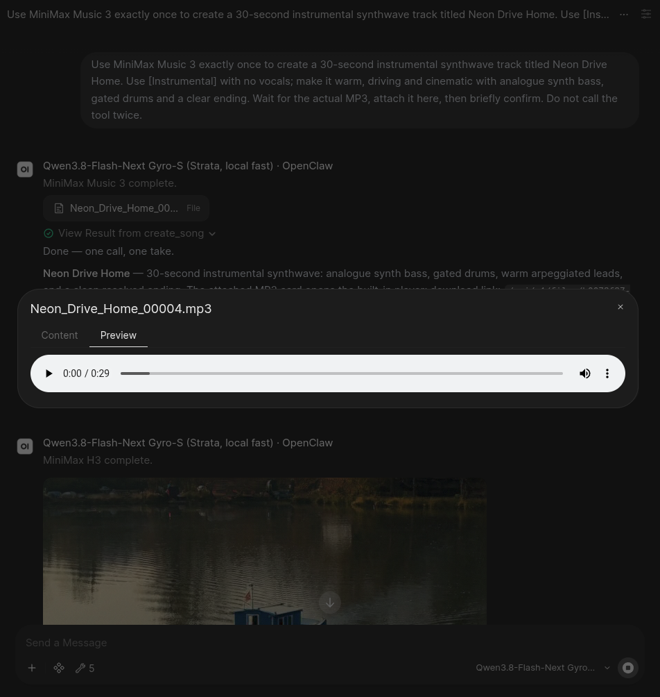
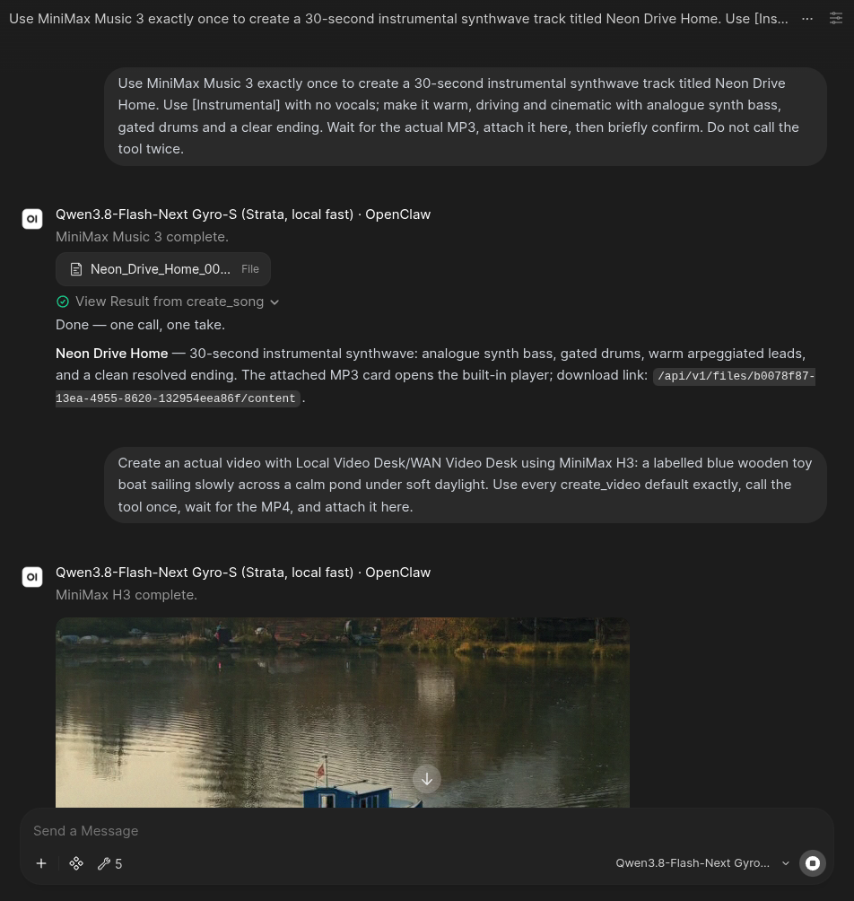
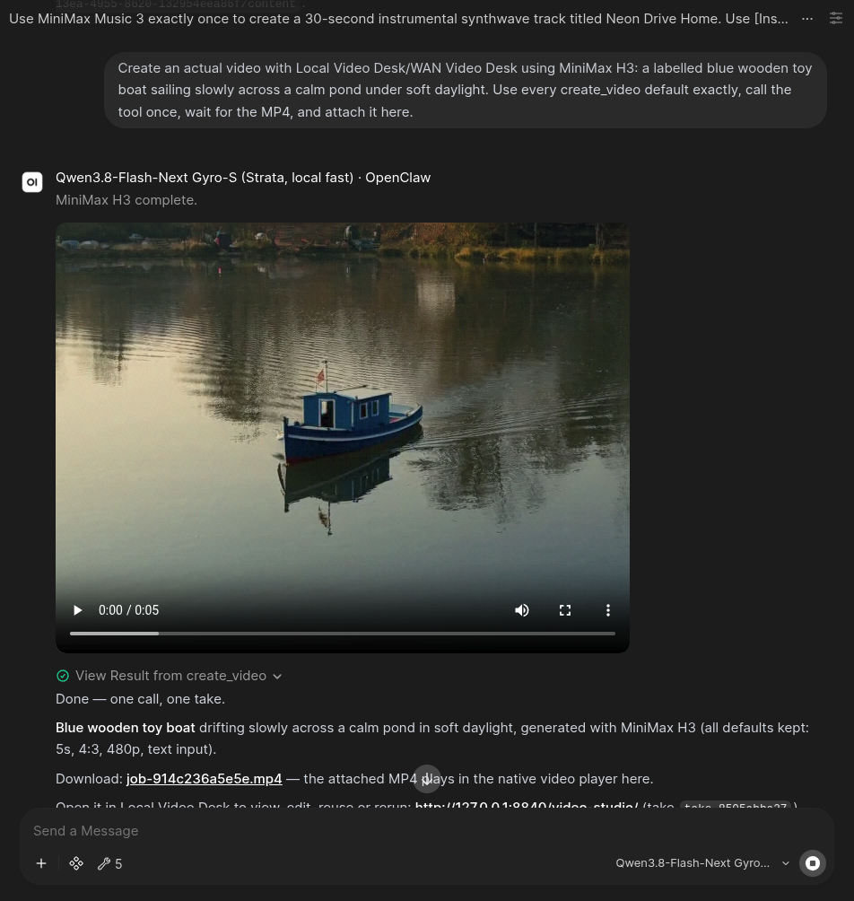

# Browser showcase

The standalone-app captures began with the accepted reference-machine browser
paths on 16 October 2026. The saved-chat captures were refreshed on 12 November
2026. They demonstrate UI integration; they do not bundle the pictured media,
chats, user database, browser profile or model weights. The Open WebUI captures
use real saved canary chats with the identity sidebar hidden and no local
absolute filesystem paths shown.

## Standalone creative apps

### MiniMax Music 3

### Qwen Image Desk

### WAN Video Desk

## Open WebUI saved-chat embeds

These captures use Qwen3.8-Flash-Next Gyro-S served by
[Strata](https://github.com/Niko1221/Strata) as the local OpenClaw model.
Alpha.19 can install the pinned Strata source and configuration, while the model
weights remain separate downloads and are not bundled by Rhizome Stack.

### Qwen text-to-image

### Qwen reference-conditioned edit

### Open WebUI native MiniMax MP3 Preview

### One saved-chat media sequence

### Inline MiniMax H3 MP4

The generated and edited PNGs use Open WebUI's normal image branch. The MP3 uses
its native File card and Preview tab. The MP4 uses the version-pinned,
hash-guarded frontend replacement documented in
[Open WebUI local media](OPENWEBUI_MEDIA.md). The screenshots prove these
specific reference-machine browser paths; they are not clean-machine acceptance
for Strata or the creative profile.
